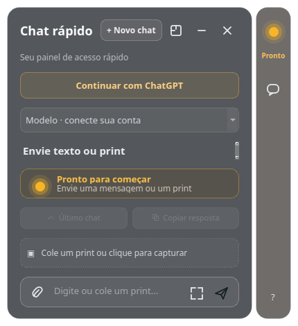

# QuickPane

**A lightweight, floating ChatGPT panel for Linux.** QuickPane keeps text chat and screenshot questions close to your work, with a compact translucent window, keyboard shortcuts, and clear response status.

## Features

- Floating translucent panel that stays above other windows and can be moved.
- Sign in with ChatGPT using the local OAuth flow; no API key is embedded in the application.
- Stream text responses from models available to the signed-in account.
- Paste screenshots, capture a screen region, or attach PNG, JPEG, and WebP images.
- Yellow pulsing status while a response is running and green status when it completes.
- Compact mode expands as the response arrives and collapses after 20 seconds.
- Start a clean chat, reopen the previous chat, copy the latest answer, and automatically start fresh after an inactivity interval.
- Chat context remains on the local computer; Responses API requests use store=false.

## Languages and technologies

- Application language: Python 3.10+
- UI: PyQt6
- Chat: OpenAI Responses API using Sign in with ChatGPT
- Desktop target: Linux, designed for KDE/Wayland
- Screenshot capture: KDE Spectacle

## Keyboard shortcuts

| Shortcut | Action |
|---|---|
| Ctrl+Alt+Space | Show or hide QuickPane (assign in KDE System Settings) |
| Ctrl+Alt+P | Capture a screen region (assign in KDE System Settings) |
| Ctrl+N | Start a new chat |
| Ctrl+Enter | Send the current message |
| Ctrl+Shift+C | Copy the latest answer |
| Ctrl+V | Paste an image from the clipboard |
| Esc | Hide the panel |

Global shortcuts are assigned by the desktop environment. Run python3 install_shortcut.py, then open System Settings → Shortcuts and set the QuickPane launcher bindings.

## Requirements

- Linux desktop; KDE Plasma and Wayland are the primary target.
- Python 3.10 or newer.
- PyQt6, Requests, and PyJWT with cryptography (see requirements.txt).
- KDE Spectacle for region capture. Text chat and pasted or attached images do not require Spectacle.
- A ChatGPT account eligible for the Sign in with ChatGPT local-app flow.

## Run

    python3 -m venv .venv
    . .venv/bin/activate
    python -m pip install -r requirements.txt
    ./run.sh

Select Continue with ChatGPT and finish authorization in the browser. QuickPane stores OAuth session data under ~/.config/painel-chat/session.json with owner-only file permissions. This legacy directory name is retained for existing installations.

## Privacy and security

- OAuth tokens are stored locally with restrictive file permissions and are excluded from version control.
- Each Responses API request uses store=false; the panel keeps only the current and previous chat in process memory.
- Screenshots are attached only when the user pastes, selects, or captures them.
- This application is an independent community project and is not an official OpenAI product.

## Current limitations

- Linux distributions beyond the tested KDE setup may need desktop-specific shortcut configuration.
- Wayland global shortcut registration is controlled by the desktop environment.
- Conversation state is not persisted after the application exits.
- Audio transcription and browser-based website editing are not included.

## Development

    python -m py_compile main.py ui.py api.py auth.py install_shortcut.py

Review the official [Sign in with ChatGPT quickstart](https://developers.openai.com/siwc/quickstart), [models and inference guide](https://developers.openai.com/siwc/token-sharing-open-source/models-and-inference), and [preview limitations](https://developers.openai.com/siwc/token-sharing-open-source/preview-limitations).
